# Ewan Begley

Computer Science and Artificial Intelligence graduate (BSc, Aberystwyth University, 2026), working towards a career in robotics.

I build and compare learning systems: reinforcement learning, genetic algorithms, NEAT and spiking networks, trained on control tasks and benchmarks written from scratch, with repeated seeds and held-out tests so the comparisons are fair. Alongside that, I'm studying the dynamics and control behind robotics.

## Selected projects

### [Neural Arena](https://github.com/Ewan1303/Neural-Arena)

PPO, a genetic algorithm and NEAT trained on four control tasks: landing a spacecraft, a lander that has to remember a blinking beacon, a drone flying to waypoints and a car racing on random tracks. 408 training runs compare activation functions, architectures, training time and scores.

**Key finding:** no training method won everywhere. PPO led on the drone, the genetic algorithm on the beacon lander, and NEAT solved the lander and the racer with networks 50 to 200 times smaller than the fixed ones.

Python · PyTorch · NumPy

### [Neural Efficiency](https://github.com/Ewan1303/Neural-Efficiency)

How fast does the cost of training grow as a task gets harder? A genetic algorithm, NEAT, a backprop network and a spiking network climb five task ladders (parity, majority, spirals, glyphs and a robot arm). 881 runs measure time, steps, examples and weights at every rung, with growth curves fitted to each.

**Key finding:** whether the cost explodes depends on the task, not the learner. On parity, every extra input bit doubled backprop's training time (3 ms at 2 bits, 5.4 s at 12); on majority, with the same inputs, it grew in a straight line.

Python · PyTorch · NumPy

### [Neural Size](https://github.com/Ewan1303/Neural-Size)

How big does a feed-forward network need to be, and where should its weights go? 3,965 training runs of 698 networks on six tasks cover size, depth, first-layer width with 1,000 inputs, shape, activation function and cost.

**Key finding:** the size a task needs is set by the task, not by its number of inputs, and past that size extra weights buy almost nothing. On the spirals, 320 times as many parameters raised accuracy from 99.8% to 99.9%.

Python · PyTorch · NumPy

### [Poker Tournament](https://github.com/Ewan1303/Poker-Tournament)

A no-limit hold'em engine, tournament runner and web app for a bot-building competition. Everyone builds a bot however they like, from hand-written rules to reinforcement learning, and the organiser plays every bot against the rest over a thousand tournaments.

Python · JavaScript · Docker

## Education

**BSc Computer Science and Artificial Intelligence**, Aberystwyth University, 2026

Final-year project: [Evolving Intelligent Agents for Unknown Tasks using Genetic Algorithms](https://github.com/Ewan1303/Evolving-Intelligent-Agents-for-Unknown-Tasks-using-Genetic-Algorithms). It implements NEAT in plain Python and measures which settings (mutation strength, selection, elitism, crossover and starting topology) work best in different fitness landscapes. [Read the report](https://docs.google.com/document/d/1-rRv-bY-L03CynCe2jSer02WEVu4wYjsx1XZUhHTXPI/edit?tab=t.0)

## Other projects

- **[Rubik's Cube Rings](https://github.com/Ewan1303/Rubiks-Cube-Rings):** a playable Rubik's cube drawn as nine rings beside the same cube in perspective, with a two-phase solver.
- **[Storage Visualizer](https://github.com/Ewan1303/Storage-Visualizer):** a treemap and sunburst disk-usage explorer for Windows, built with PySide6.
- **[Machine Learning](https://github.com/Ewan1303/Machine-Learning):** practice code from a self-study course on neural networks, from a single neuron by hand to continual and reinforcement learning.

## Tools

Used across my 25 repositories, 10 public and 15 private.

<picture>
  <source media="(prefers-color-scheme: dark)" srcset="https://skillicons.dev/icons?i=python%2Cpytorch%2Cts%2Cjs%2Creact%2Cthreejs%2Celectron%2Cfastapi%2Cvite%2Cqt%2Cdocker%2Cgithubactions%2Clua%2Cblender%2Cgit&perline=15&theme=dark" />
  
</picture>

- **Methods:** reinforcement learning (PPO), genetic algorithms, NEAT, spiking neural networks
- **Also:** NumPy, pandas, React Native with Expo, SQLAlchemy, Streamlit, Chrome extensions, Typst

 

<picture>
  <source media="(prefers-color-scheme: dark)" srcset="https://raw.githubusercontent.com/Ewan1303/Ewan1303/output/github-snake-dark.svg" />
  <source media="(prefers-color-scheme: light)" srcset="https://raw.githubusercontent.com/Ewan1303/Ewan1303/output/github-snake.svg" />
  
</picture>

The snake plays Snake on my contribution graph: it eats every square, grows with each one and plans a route that never runs into itself. <a href="https://github.com/Ewan1303/Ewan1303/tree/main/snake">How it works</a>
